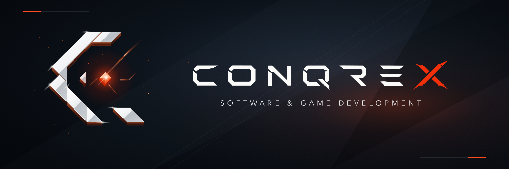
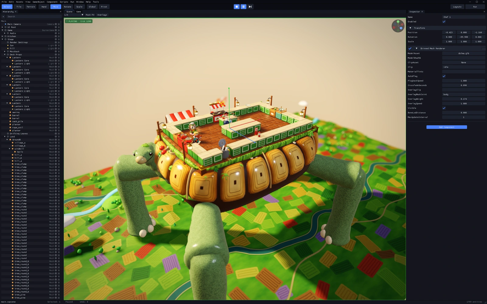
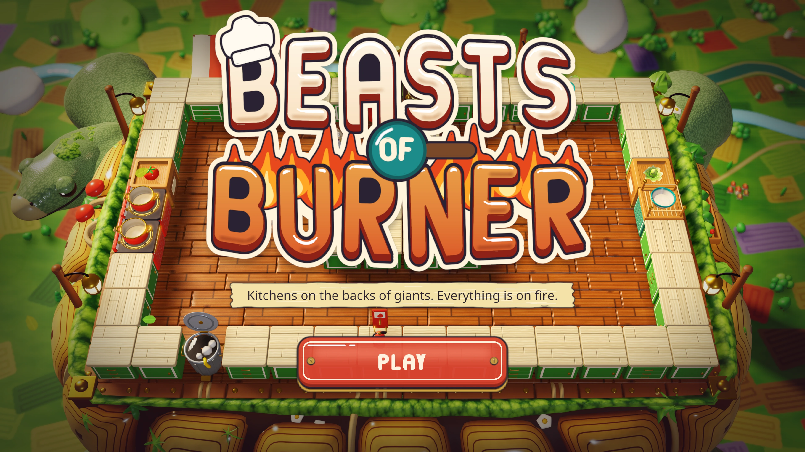
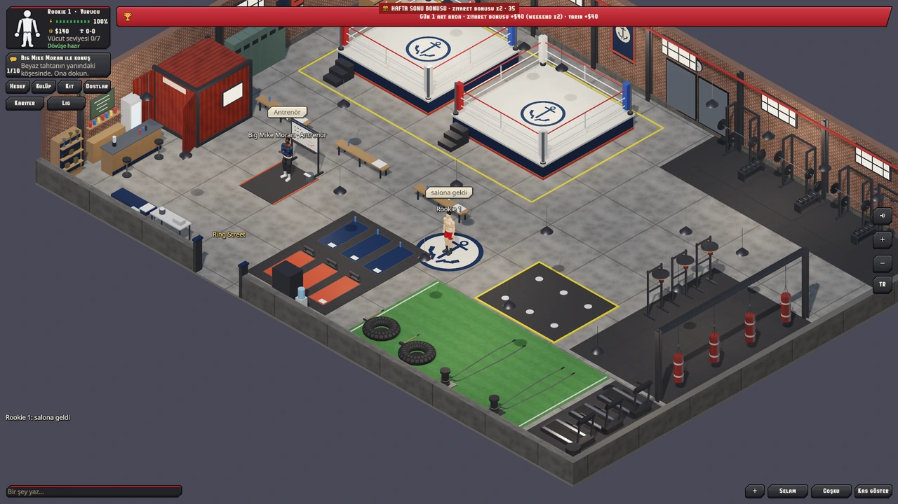

<h3><code>CODE. CREATE. CONQUER.</code></h3>

<b>An independent software &amp; game development studio.</b> 
We build our own engine, our own tooling, our own networking — 
then we build games on top of them.

  
  

  <a href="https://conqrex.com"><b>Website</b></a> ·
  <a href="https://conqrex.com/engine"><b>Engine</b></a> ·
  <a href="#games"><b>Games</b></a> ·
  <a href="#open-source"><b>Open Source</b></a> ·
  <a href="https://conqrex.com/about"><b>Studio</b></a> ·
  <a href="#support-the-work"><b>Support</b></a> ·
  <a href="mailto:sancak@conqrex.com"><b>Contact</b></a>

---

## Conqrex.Engine

**In active development · Public engine access is not available yet.**

A **C# / .NET 10** engine for **2D, isometric, and 3D** games. Build the scene, shape its characters, paint their surfaces, compose the soundtrack, and give it all rules to play by. The creative tools and the runtime grow together through the games we make.

**Built-in creation tools. No local AI model required.** The models, materials, animations, and music in Beasts of Burner and Knux were created with the engine’s built-in tools, without running local generative AI models. [Forge](https://conqrex.com/engine#tool-forge) is an optional integration for a separately installed local image model; it was not used in either game.

*Beasts of Burner in the editor. An actual project capture, with the kitchen, characters, and surrounding world in one scene.*

| Area | What we are building |
| --- | --- |
| **Workspace** | The project Hub, scenes, nested prefabs, a multi-object Inspector, C# components, hot reload, and play controls. |
| **Creative tools** | Sculpt for 3D modelling, Canvas for textures and materials, Rig for animation, Pixel for sprites, and Music for composition and adaptive audio. Shader Graph, particles, dialogue, and cinematic timelines extend the workflow. |
| **Runtime** | Fixed-step simulation and interpolated rendering; 2D and 3D physics, navigation, animation, game UI, input, and audio. |
| **Rendering** | WebGPU and native `wgpu` backends, with a more limited WebGL2 compatibility tier. Advanced rendering features vary by backend. |
| **AI-assisted authoring** | Hosted AI assistants can operate the built-in tools without local model inference. Built-in chat and external MCP clients can inspect projects, use supported editor operations, run play sessions, and capture results. GameSpec and Autonomous Studio workflows are evolving. |
| **Networking** | Replicated state, remote calls, client prediction, reconciliation, and dedicated servers. Hosting and game-specific online services require separate setup; internet-scale qualification is ongoing. |
| **Build targets** | Desktop, WebAssembly, Android, and headless server Players. These are development targets; the publicly playable game previews below run in the browser. |

**[Explore the engine and its current capabilities](https://conqrex.com/engine)**

## Games

Two worlds made with Conqrex.Engine. Both are **in development**, with **browser previews** you can play today.

### Beasts of Burner

**Kitchens on the backs of giants. Everything is on fire.**

A 3D cooking party game where animal chefs prepare and serve orders on enormous living creatures. The kitchen, the characters, and the soundtrack were built alongside the engine tools that make them possible.

**[Play in your browser](https://burner.conqrex.com/)** · **[Explore the making of](https://conqrex.com/showcase/burner)**

### Knux

**Find your gym. Build your fighter. Earn your place.**

An isometric 3D boxing RPG built around training, fighter progression, and life around the gym. Explore its neighbourhoods, characters, and the systems behind the bouts.

**[Play in your browser](https://knux.conqrex.com/)** · **[Explore the making of](https://conqrex.com/showcase/knux)**

The showcases include development captures, interactive 3D models, original music, and the process from early shapes to playable scenes. Desktop downloads are not currently offered on the site.

## Open source

Tools we built for our own workflow and released for yours.

| Project | What it does |
| --- | --- |
| **[Conqrex.CrewBeacon](https://github.com/Conqrex/Conqrex.CrewBeacon)** | Monitor AI provider quota, weekly limits, live local and remote Paseo agents, attention states and detailed daily usage history from one KDE Plasma 6 panel widget. |
| **[Conqrex.OctoPulse](https://github.com/Conqrex/Conqrex.OctoPulse)** | Every GitHub Actions run across all your repos and orgs, live in one KDE Plasma 6 panel widget — re-run, cancel, dispatch and read logs without opening a browser tab. |
| **[Conqrex.Dockswain](https://github.com/Conqrex/Conqrex.Dockswain)** | Manage Docker hosts over SSH from your panel: containers, compose, logs, SFTP file manager and nginx/certbot tooling. |

Issues and pull requests are welcome on every public repository.

## Support the work

Conqrex is an independent studio. If you enjoy the games, tools, or the process behind them, you can support Serhan’s work on Conqrex through **[Buy Me a Coffee](https://buymeacoffee.com/sancak)**.

It is an optional way to support the work. Playing the previews, sharing feedback, and contributing to the public tools also help.

## Work with us

For collaboration, future engine access, or a question about our work, reach us at **[sancak@conqrex.com](mailto:sancak@conqrex.com)**.

---

**[conqrex.com](https://conqrex.com)** · [sancak@conqrex.com](mailto:sancak@conqrex.com) · [@SancaK9](https://github.com/SancaK9)

 

<a href="https://conqrex.com">
  <picture>
    <source media="(prefers-color-scheme: dark)" srcset="assets/conqrex-wordmark-dark.svg">
    
  </picture>
</a>

