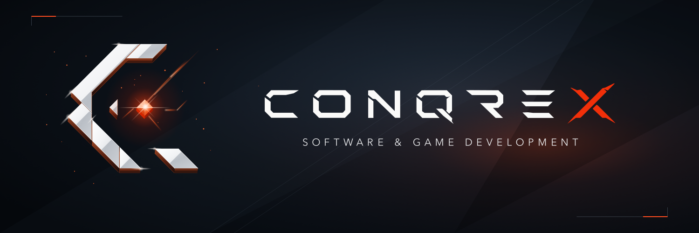
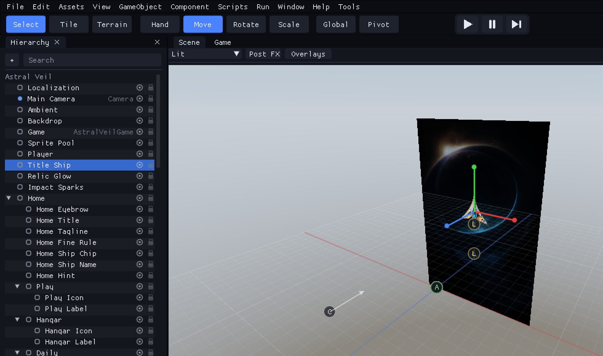
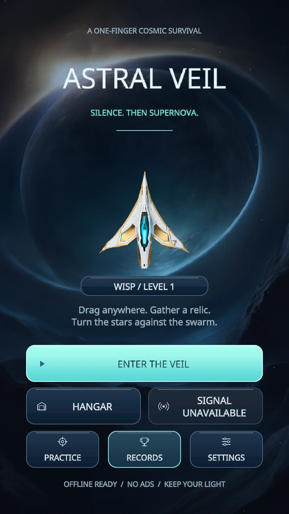
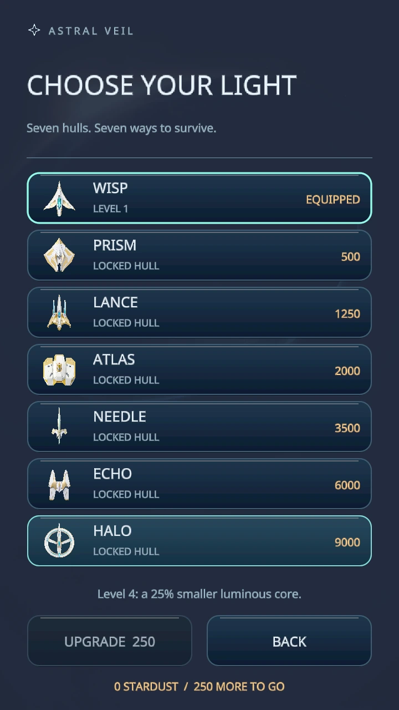

<h3><code>CODE. CREATE. CONQUER.</code></h3>

<b>An independent software &amp; game development studio.</b> 
We build our own engine, our own tooling, our own networking — 
then we build games on top of them.

  
  
  
  

  <a href="https://conqrex.com"><b>Website</b></a> ·
  <a href="https://conqrex.com/engine"><b>Engine</b></a> ·
  <a href="#open-source"><b>Open Source</b></a> ·
  <a href="https://conqrex.com/about"><b>About</b></a> ·
  <a href="mailto:sancak@conqrex.com"><b>Contact</b></a>

---

## Conqrex.Engine

One C# codebase rendering **2D, 2.5D isometric and 3D** — the foundation under every Conqrex title.

|     |     |
| --- | --- |
| **Every surface** | One codebase ships to the browser (WebAssembly), Android and desktop (Windows / macOS / Linux), plus a headless dedicated server. |
| **Deterministic core** | A project-selected fixed simulation tick (30–180 Hz, 60 by default) with fixed-point math; rendering interpolates as fast as the surface allows. |
| **Our own GPU layer** | A WebGPU-first rendering hardware interface, with WebGL2 and native `wgpu` backends behind it. |
| **Tools in one editor** | Scenes and prefabs, tile and terrain tools, pixel art (Conqrex Pixel), music (Conqrex Music) and built-in 3D modelling, next to physics, animation, audio and UI. |
| **Human + AI authoring** | AI-assisted tools work through the same operations as the editor's own menus, so every change lands in the undo history. |
| **Multiplayer, in progress** | RPCs, synchronised variables, observers, client prediction and reconciliation, with a dedicated server Player. |

The engine is in active development and public access is not available yet.

**[→ Meet the engine](https://conqrex.com/engine)**

## Games

**Astral Veil** is in development on Conqrex.Engine: a one-finger cosmic survival arcade with seven ships and eleven relics.

  
  &nbsp;
  

Announcements land at **[conqrex.com](https://conqrex.com)**.

## Open source

Tools we built for our own workflow and released for yours.

| Project | What it does |
| --- | --- |
| **[Conqrex.CrewBeacon](https://github.com/Conqrex/Conqrex.CrewBeacon)** | Monitor AI provider quota, weekly limits, live local and remote Paseo agents, attention states and detailed daily usage history from one KDE Plasma 6 panel widget. |
| **[Conqrex.OctoPulse](https://github.com/Conqrex/Conqrex.OctoPulse)** | Every GitHub Actions run across all your repos and orgs, live in one KDE Plasma 6 panel widget — re-run, cancel, dispatch and read logs without opening a browser tab. |
| **[Conqrex.Dockswain](https://github.com/Conqrex/Conqrex.Dockswain)** | Manage Docker hosts over SSH from your panel: containers, compose, logs, SFTP file manager and nginx/certbot tooling. |

Issues and pull requests are welcome on every public repository.

## Work with us

Engine licensing, collaboration, or just a good question —
reach us at **[sancak@conqrex.com](mailto:sancak@conqrex.com)**.

---

**[conqrex.com](https://conqrex.com)** · [sancak@conqrex.com](mailto:sancak@conqrex.com) · [@SancaK9](https://github.com/SancaK9)

 

<a href="https://conqrex.com">
  <picture>
    <source media="(prefers-color-scheme: dark)" srcset="assets/conqrex-wordmark-dark.svg">
    
  </picture>
</a>

